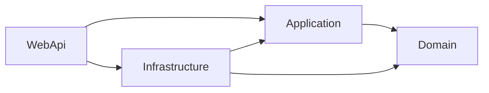
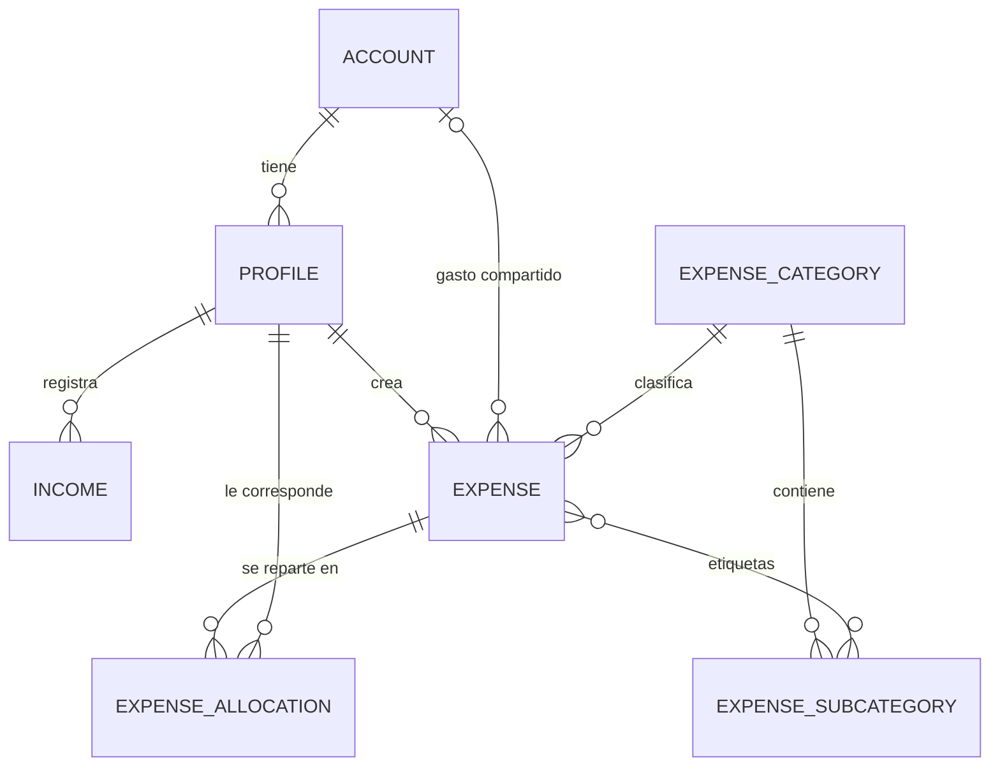
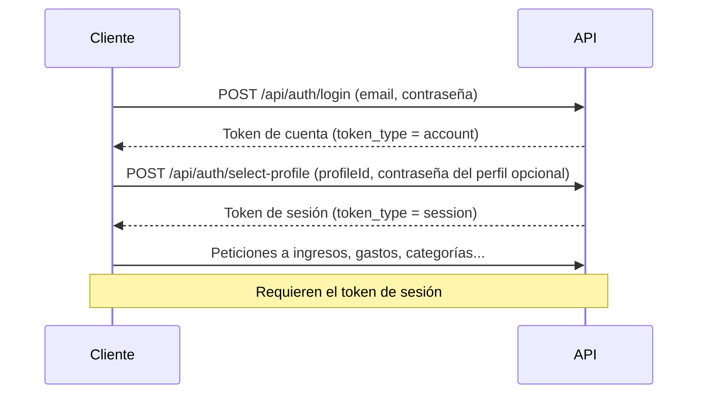

# FinTrack

API REST para el seguimiento de gastos e ingresos personales y compartidos. Una cuenta agrupa varios perfiles (por ejemplo, los miembros de un hogar), y los gastos compartidos se reparten entre los perfiles que participan.

Es un proyecto personal con el que practico arquitectura limpia y diseño orientado al dominio en .NET: la lógica de negocio vive en el dominio, los casos de uso están separados de la infraestructura y los errores esperados se modelan con el patrón Result en lugar de excepciones.

**Stack:** C#, .NET 10, ASP.NET Core, EF Core, SQL Server, MediatR, FluentValidation, JWT, Scalar (OpenAPI), xUnit y NSubstitute.

## Qué demuestra este proyecto

- **Clean Architecture + DDD + CQRS:** capas con dependencias hacia el dominio, comandos y consultas con MediatR, validación con FluentValidation.
- **Dominio rico:** las entidades (`Expense`, `Income`, `Profile`, `Account`) protegen sus propias reglas y los objetos de valor (`Money`, `DateRange`) evitan estados inválidos.
- **Manejo de errores con `Result`:** los fallos de negocio son valores explícitos, y un manejador global de excepciones cubre lo inesperado con `ProblemDetails`.
- **Autenticación en dos etapas:** primero se inicia sesión con la cuenta y luego se elige un perfil, con un token distinto para cada paso y políticas de autorización por tipo de token.
- **Persistencia:** repositorios + Unit of Work sobre EF Core; las migraciones y el seed de categorías se aplican al iniciar.
- **Pruebas unitarias del dominio** con xUnit y NSubstitute.

## Arquitectura

```
FinTrack.slnx
├── src/
│   ├── FinTrack.Domain          # Entidades, objetos de valor, errores, contratos de repositorio
│   ├── FinTrack.Application     # Comandos, consultas, handlers y validadores (MediatR)
│   ├── FinTrack.Infrastructure  # EF Core, repositorios, JWT, hash de contraseñas, seed
│   └── FinTrack.WebApi          # Controladores, autenticación, OpenAPI/Scalar
└── tests/
    └── FinTrack.Domain.UnitTests
```



## Modelo del dominio



- Una **cuenta** tiene uno o varios **perfiles**. Al registrarse se crea el primer perfil, que es administrador.
- Un perfil puede protegerse con una **contraseña del perfil** opcional.
- Un **gasto** es personal del perfil o compartido con la cuenta; en el segundo caso se asigna cuánto le corresponde a cada perfil mediante **asignaciones**.

## Flujo de autenticación



Dos políticas de autorización separan ambos tokens: `AccountOnly` (solo selección de perfil) y `SessionRequired` (el resto de recursos).

## Endpoints principales

La documentación interactiva completa está en Scalar (ver [Ejecución local](#ejecución-local)).

| Recurso | Método y ruta | Descripción |
|---|---|---|
| Auth | `POST /api/auth/register` | Crea la cuenta y su perfil administrador |
| Auth | `POST /api/auth/login` | Inicia sesión y devuelve el token de cuenta |
| Auth | `POST /api/auth/select-profile` | Elige un perfil y devuelve el token de sesión |
| Perfiles | `GET /api/profiles` | Lista los perfiles de la cuenta |
| Perfiles | `POST /api/profiles` | Crea un perfil (solo administrador) |
| Perfiles | `PUT /api/profiles/{id}` | Actualiza un perfil |
| Perfiles | `POST /api/profiles/{id}/protection/activate` | Activa la protección con contraseña del perfil |
| Perfiles | `POST /api/profiles/{id}/protection/deactivate` | Desactiva la protección |
| Ingresos | `GET /api/incomes/{id}` · `GET /api/incomes/profile/{profileId}` | Consulta por id y listado por perfil |
| Ingresos | `POST /api/incomes` · `PUT /api/incomes/{id}` · `DELETE /api/incomes/{id}` | Crear, actualizar y eliminar |
| Gastos | `GET /api/expenses/{id}` | Consulta por id |
| Gastos | `GET /api/expenses/profile/{profileId}` | Gastos del perfil |
| Gastos | `GET /api/expenses/account/{accountId}` | Gastos compartidos de la cuenta |
| Gastos | `POST /api/expenses` · `PUT /api/expenses/{id}` · `DELETE /api/expenses/{id}` | Crear, actualizar y eliminar |
| Gastos | `POST /api/expenses/{id}/allocate` | Asigna a un perfil su parte de un gasto compartido |
| Categorías | `GET /api/expense-categories` | Categorías y subcategorías de gasto |

## Ejecución local

**Requisitos:** [.NET SDK 10](https://dotnet.microsoft.com/download), Docker y `openssl` (opcional, para generar la clave JWT).

**1. Clonar y preparar variables de entorno**

```bash
git clone https://github.com/joelc24/FinTrack.git
cd FinTrack
cp .env.template .env
```

Edita `.env` y define `DB_PASSWORD` (debe cumplir la política de contraseñas de SQL Server).

**2. Levantar SQL Server**

```bash
docker compose up -d
```

**3. Configurar los secretos de la API**

`appsettings.json` solo contiene valores de ejemplo; los reales se guardan con *user-secrets*:

```bash
cd src/FinTrack.WebApi
dotnet user-secrets set "ConnectionStrings:DefaultConnection" "Server=localhost,1433;Database=FinTrack;User Id=sa;Password=<tu DB_PASSWORD>;TrustServerCertificate=True;Encrypt=False;"
dotnet user-secrets set "Jwt:SecretKey" "$(openssl rand -base64 32)"
```

**4. Ejecutar la API**

```bash
dotnet run --launch-profile https
```

Al iniciar, la API aplica las migraciones y carga el seed de categorías de gasto automáticamente. En desarrollo, la documentación interactiva queda disponible en `https://localhost:7219/scalar` (o `http://localhost:5185/scalar`).

> El `Dockerfile` de `FinTrack.WebApi` genera la imagen de la API, pero el `compose.yml` por ahora solo levanta la base de datos.

## Pruebas

```bash
dotnet test
```

## Limitaciones conocidas y próximos pasos

- Los listados de gastos aún no están paginados.
- La validación de pertenencia del recurso en los handlers está en revisión.
- Hay pruebas unitarias de parte del dominio; faltan más entidades, handlers y pruebas de integración (con Testcontainers).
- Balance por perfil (ingresos menos lo pagado): pendiente.
- Autenticación: definir duraciones distintas para el token de cuenta y el de sesión, y agregar refresh token.
- Agregar la API al `compose.yml` para levantar todo con un solo comando.

## Frontend

Cliente web en Angular (Angular Material y Tailwind) que consume esta API: [FinTrack Web](https://github.com/joelc24/fintrack-web). Está en desarrollo.
